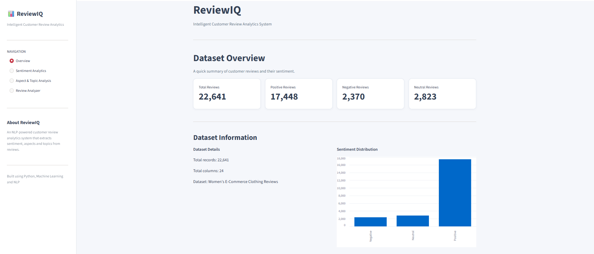
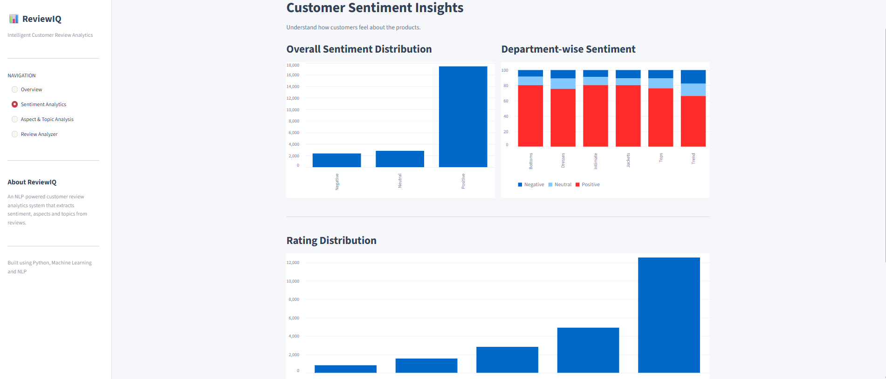
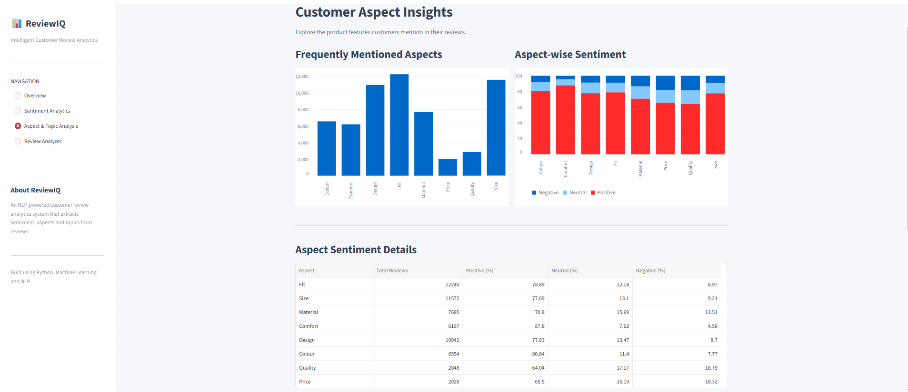
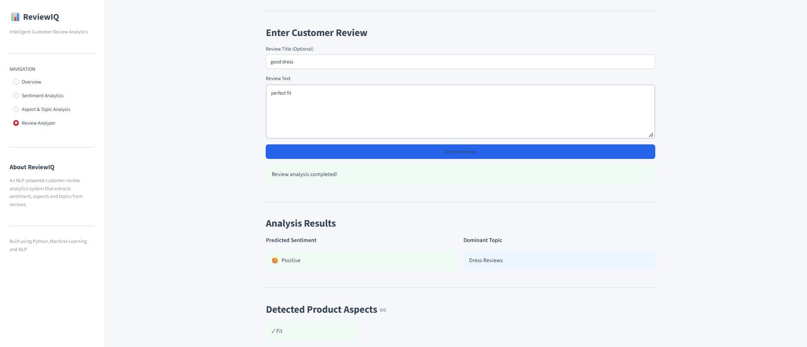

# ReviewIQ – Intelligent Customer Review Analytics System

ReviewIQ is a machine learning and NLP-based application that analyzes customer reviews to identify sentiment, detect frequently discussed product aspects, and discover common review topics.

The system uses the Women's E-Commerce Clothing Reviews dataset and provides an interactive Streamlit dashboard for exploring customer feedback and analyzing new reviews.

## Features

- **Sentiment Analysis:** Classifies reviews into Positive, Negative, and Neutral categories.
- **Aspect Analysis:** Identifies product aspects such as Fit, Size, Material, Comfort, Design, Colour, Quality, and Price.
- **Topic Modeling:** Discovers common themes in customer reviews using Non-negative Matrix Factorization (NMF).
- **Review Analyzer:** Predicts sentiment, detected aspects, and dominant topic for newly submitted reviews.
- **Interactive Dashboard:** Visualizes sentiment distribution, aspect-level feedback, and topic distribution.

## Application Screenshots

### Overview


### Sentiment Analytics


### Aspect & Topic Analysis


### Review Analyzer


## Technologies Used

- Python
- Pandas, NumPy
- Matplotlib, Seaborn
- NLTK
- Scikit-learn
- TF-IDF
- Multinomial Naive Bayes
- Logistic Regression
- Non-negative Matrix Factorization (NMF)
- Streamlit
- Joblib

## Project Workflow

1. Data Understanding
2. Data Preprocessing
3. Exploratory Data Analysis
4. Sentiment Analysis
5. Topic and Aspect Analysis
6. Model Integration
7. Streamlit Dashboard Development

## Machine Learning Results

Three classification approaches were evaluated:

| Model | Accuracy | Macro F1-score | Weighted F1-score |
|---|---:|---:|---:|
| Multinomial Naive Bayes | 79.91% | 0.45 | 0.74 |
| Logistic Regression | 83.59% | 0.61 | 0.81 |
| Balanced Logistic Regression | 80.86% | 0.65 | 0.82 |

Balanced Logistic Regression was selected as the final model because it achieved the highest Macro F1-score and provided better performance across minority sentiment classes.

## Aspect Analysis

The system detects eight product-related aspects using keyword-based matching.

| Aspect | Positive Feedback (%) | Negative Feedback (%) |
|---|---:|---:|
| Fit | 78.89 | 8.97 |
| Size | 77.69 | 9.21 |
| Material | 70.80 | 13.51 |
| Comfort | 87.80 | 4.58 |
| Design | 77.83 | 8.70 |
| Colour | 80.84 | 7.77 |
| Quality | 64.04 | 18.79 |
| Price | 65.50 | 18.32 |

Quality and Price received comparatively higher negative feedback, while Comfort had the highest positive feedback percentage.

## Topic Modeling

NMF was used to discover eight major topics from customer reviews.

The identified topics include:

1. General Feedback
2. Dress Reviews
3. Jeans & Pants
4. Size & Fitting
5. Tops Reviews
6. Sweaters & Winter Wear
7. Shirts & T-shirts
8. Positive Feedback

Each review is assigned a dominant topic based on its highest topic weight.

## Project Structure

```text
ReviewIQ/
│
├── app/
│   └── dashboard.py
│
├── data/
│   ├── raw/
│   └── processed/
│
├── models/
│
├── notebooks/
│   ├── 01_Data_Understanding.ipynb
│   ├── 02_Data_Preprocessing.ipynb
│   ├── 03_Exploratory_Data_Analysis.ipynb
│   ├── 04_Sentiment_Analysis.ipynb
│   └── 05_Topic_and_Aspect_Analysis.ipynb
│
│
├── src/
│   ├── preprocessing.py
│   ├── sentiment.py
│   ├── aspect_analysis.py
│   ├── topic_modeling.py
│   └── prediction.py
│
├── .gitignore
├── requirements.txt
└── README.md
```

## Installation and Setup

### 1. Clone the repository

```bash
git clone https://github.com/itz-me-sree/ReviewIQ.git
cd ReviewIQ
```

### 2. Create a virtual environment

```bash
python -m venv venv
```

Activate it:

**Windows:**
```bash
venv\Scripts\activate
```

**Linux / macOS:**
```bash
source venv/bin/activate
```

### 3. Install dependencies

```bash
pip install -r requirements.txt
```

### 4. Run the application

```bash
streamlit run app/dashboard.py
```

The dashboard will open in your browser.

## Dataset

This project uses the Women's E-Commerce Clothing Reviews dataset.

The dataset contains customer reviews, product information, ratings, and demographic details.

## Important Notes and Limitations

- Sentiment labels are derived from ratings: ratings 1–2 are Negative, rating 3 is Neutral, and ratings 4–5 are Positive. They are not manually annotated text labels.
- Aspect detection is keyword-based and may miss synonyms or context-dependent expressions.
- Topic labels are manually interpreted from the topics generated by NMF.
- A review can mention multiple aspects, but only one dominant topic is assigned.
- Aspect sentiment percentages represent rating-derived sentiment among reviews mentioning each aspect. They are not independently annotated aspect-level sentiment labels.

## Author

**Sreerag S**

B.Tech Computer Science and Engineering
